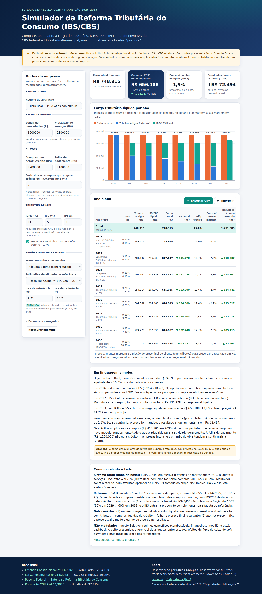

# Simulador da Reforma Tributária do Consumo (IBS/CBS)

**Year-by-year estimate of how Brazil's consumption-tax reform (2026–2033) affects a business's tax burden, prices and margins.**

The tool turns the transition rules of Constitutional Amendment 132/2023 and Complementary Law 214/2025 into a tested calculation engine. It compares the current system (PIS/Cofins, ICMS, ISS, IPI) with the new dual VAT (CBS and IBS) for each year of the transition.

**Live demo:** https://lucasthobias.github.io/simulador-ibs-cbs/



> ⚠️ **Educational estimate, not tax advice.** IBS/CBS reference rates will be set by the Federal Senate, and several points still depend on regulation. Results rely on simplifying assumptions, all documented below, and do not replace a professional analysis based on real company data.

---

## Why this project

The reform replaces five taxes with a non-cumulative, tax-exclusive ("por fora") dual VAT through an eight-year phase-in. Business owners need a simple answer to a hard question: *what happens to my tax burden and my prices each year?* This project answers it with a calculator that:

- **cites its sources.** Every legal parameter is mapped to the constitutional or statutory provision, or to the official estimate, it comes from ([docs/fontes.md](docs/fontes.md)).
- **labels what is not settled.** Anything not yet regulated is an editable parameter marked as an assumption ("premissa").
- **is tested.** The engine is a pure ES module with 31 unit tests covering the transition schedule, rate reductions, regimes and invariants.
- **has zero dependencies.** It needs no build step, no CDN and no framework. The chart is hand-made SVG and the page deploys as-is on GitHub Pages.

## Features

- **Inputs:** revenue from goods and from services, purchases that generate credit, payroll (no credit), and current regime: Lucro Real (non-cumulative PIS/Cofins), Lucro Presumido (cumulative) or Simples Nacional (simplified model).
- **Current taxes:** effective ICMS, ISS and IPI rates, plus optional exclusion of ICMS from the PIS/Cofins base (STF Theme 69).
- **Reform parameters:** sector treatment (standard rate, 30% reduction, 60% reduction, zero rate) and editable CBS/IBS reference rates, with presets from official estimates.
- **Advanced assumptions:** effective credit on purchases, credit retention for zero-rated sales, IBS/CBS inside the ICMS/ISS base during the transition (a disputed point), and IPI kept for Manaus Free Trade Zone products.
- **Outputs for 2026–2033:**
  - net tax burden, current system vs. reform, as an SVG stacked-bar chart with keyboard-accessible tooltips and a table
  - effective rate on the price charged
  - price change needed to keep the margin in R$
  - profit impact if prices stay unchanged
  - a plain-language explanation and context-aware warnings
- **Export:** CSV (`;`-separated with decimal commas, opens correctly in Excel pt-BR) and a print-friendly view that includes a summary of the scenario's assumptions.
- **UX:** responsive, light/dark themes, keyboard navigable, labelled inputs, `aria-live` results, and a table alternative for the chart.

## Legal basis

| Topic | Provision |
|---|---|
| 2026 test year: CBS 0.9%, IBS 0.1%, offset against PIS/Cofins or waived when filing obligations are met | EC 132/2023, ADCT art. 125; LC 214/2025, arts. 343, 346 and 348 |
| 2027: full CBS, PIS/Cofins abolished, IPI zeroed except Manaus Free Trade Zone (ZFM) products, Selective Tax starts | ADCT art. 126 |
| 2027–2028: IBS 0.05% state + 0.05% municipal; CBS reduced by 0.1 p.p. | ADCT art. 127 |
| 2029–2032: ICMS/ISS at 90%, 80%, 70%, 60% | ADCT art. 128 |
| 2033: ICMS and ISS abolished | ADCT art. 129 |
| Reference rates set by the Senate | ADCT art. 130 |
| Zero rate: National Basic Food Basket | LC 214/2025, art. 125 |
| 30% reduction: 18 regulated intellectual professions | LC 214/2025, art. 127 |
| 60% reduction: health, education, food, medicines and other listed items | LC 214/2025, art. 128 ff. |
| Simples Nacional option to pay IBS/CBS under the regular regime | LC 214/2025, art. 41 |
| ICMS/ISS excluded from the IBS/CBS base | LC 214/2025, art. 12, § 2 |
| Split payment (collection at financial settlement) | LC 214/2025, arts. 31–35 (concept only, not modelled) |

**Default reference rates:** CBS **9.21%** and IBS **18.70%** (total **27.91%**), from CGIBS Resolution No. 14 of 29 July 2026. This is the latest official estimate with an IBS figure. The CBS value is implied (27.91 − 18.70). A second preset loads the initial Ministry of Finance (SERT) estimate: 8.8% + 17.7% = 26.5%.

Full source list with URLs and access dates: **[docs/fontes.md](docs/fontes.md)**.

## Methodology

All amounts are annual. Rates are entered as percentages. `t` is the combined IBS + CBS rate for the year after any sector reduction.

### Baseline: current system (2025 rules)

```
ICMS       = icms_eff × goods revenue
ISS        = iss × services revenue
IPI        = ipi_eff × goods revenue                  (added on top of price)
PIS/Cofins = 9.25% (Lucro Real) | 3.65% (Presumido) × (revenue − ICMS if excluded)
credit     = 9.25% × purchases × share already creditable  (Lucro Real only)
burden     = ICMS + ISS + IPI + PIS/Cofins − credit
net value  = revenue − ICMS − ISS − PIS/Cofins        (sales net of consumption taxes)
result     = net value − (purchases − credit) − payroll
Simples:   burden = DAS rate × revenue
```

### Reform year `y`

```
t_y          = (CBS_y + IBS_y) × sector factor         (1 | 0.7 | 0.4 | 0)
CBS_2027-28  = CBS_ref − 0.1 p.p.;  IBS_2027-28 = 0.1%
IBS_2029-32  = IBS_ref × (1 − legacy factor)            [assumption]
legacy factor: 1 (2026–28), 0.9, 0.8, 0.7, 0.6 (2029–32), 0 (2033)

credit       = purchases × t_p / (1 + t_p)             t_p = standard rate × credit %
IBS/CBS      = t_y × N                                 (base excludes ICMS/ISS)
ICMS/ISS     = a × f × N / (1 − a × f)                  ("por dentro" at reduced rate)
price        = N + ICMS + ISS + IPI + IBS/CBS
burden       = ICMS + ISS + IPI + IBS/CBS − credit
```

The engine solves two scenarios. Both are linear in `N`, so each has a closed form:

1. **Keep margin.** Choose the net value `N` that keeps the result in R$ unchanged: `N = result₀ + (purchases − credit) + payroll`. The output is the resulting customer price and its change against today.
2. **Keep price.** Fix today's customer price, per goods and services segment, and compute `N = price₀ / multiplier`. The output is the change in annual result.

The year 2026 is neutral by design, because test amounts are offset or waived.

**Simples Nacional:** "inside the DAS" keeps the DAS burden constant. "Outside" (regular IBS/CBS from 2027) removes the PIS/Cofins share from the DAS and phases out the ICMS/ISS share with the legacy factor. Full IBS/CBS then applies with credits: `price = N(1+t) / (1 − d(1+t))`.

## Assumptions and limitations

- **Reference rates are estimates.** The Senate will set the official 2027 rates by 15 Dec 2026, after TCU review. If the estimate exceeds 26.5%, LC 214/2025 obliges the Executive to propose corrective measures, but this cap is not automatic.
- **IBS rates in 2029–2032** are approximated as the reference rate times the complementary fraction of the ICMS/ISS reduction. The actual rates will be calibrated to replace lost revenue.
- **Supplier prices:** the gross price of purchases is held constant, and credit is the IBS/CBS embedded in it. Supplier repricing is not modelled.
- **Effective ICMS/IPI rates** are already net of credits. Interstate rate differences (DIFAL), ST, benefits and credit accumulation are not modelled.
- **Not modelled:** Selective Tax, specific regimes (fuel, financial services, real estate, cooperatives etc.), cashback, presumed credits, income taxes, the cash-flow effect of split payment, and reduced rates on purchases (approximate them with the *effective credit %* input).
- **Simples Nacional** is a deliberately simplified model based on the effective DAS rate and share-of-DAS inputs (defaults: Annex I, 1st bracket).
- **Zero-rate credit retention** is an editable assumption.
- **Negative net burden** means credits exceed debits: an accumulated credit balance eligible for refund, but not necessarily cash in the same year.

## Run locally

```bash
# serve the static site (ES modules need http://, not file://)
python3 -m http.server 8080      # or: npm start
# open http://localhost:8080
```

## Tests

Requires Node.js ≥ 18 and has no dependencies:

```bash
npm test          # = node --test
```

The suite (`tests/calc.test.js`) covers:

- the transition schedule year by year
- the 30% / 60% / zero reductions
- PIS/Cofins in both regimes and the ICMS exclusion
- 2026 neutrality, PIS/Cofins and IPI extinction in 2027, and the ZFM exception
- the proportional ICMS in 2030 and the disputed IBS/CBS-in-ICMS-base option
- the keep-margin and keep-price invariants and the burden decomposition identity
- the Simples inside and outside options
- input validation, the plain-language explanation and the CSV format

## Project structure

```
index.html            UI (Portuguese), GitHub Pages entry point
assets/styles.css     Design tokens (navy + teal), responsive, dark mode, print
assets/favicon.svg
src/calc.js           Pure calculation engine (ES module, no DOM)
src/chart.js          Hand-made SVG chart with accessible tooltips
src/app.js            Form ↔ engine ↔ rendering, CSV export, print
tests/calc.test.js    node:test unit tests
docs/fontes.md        Legal parameters, sources and access dates
```

## Deploy (GitHub Pages)

Go to Settings → Pages → *Deploy from a branch* → `main` / root. No build step is needed; `.nojekyll` is included.

---

## Resumo em português

**Simulador educacional da Reforma Tributária do Consumo.** Informe as receitas de mercadorias e serviços, as compras que geram crédito, a folha, o regime atual (Lucro Real, Lucro Presumido ou Simples Nacional) e as alíquotas efetivas de ICMS, ISS e IPI. O simulador compara, ano a ano de 2026 a 2033, a carga atual com a carga sob IBS/CBS. Mostra também a alíquota efetiva, a variação de preço necessária para manter a margem e o efeito no resultado caso o preço seja mantido.

O cálculo segue o cronograma da EC 132/2023 (ADCT, arts. 125 a 130) e as regras da LC 214/2025:

- reduções de 30% e de 60% e alíquota zero
- opção do Simples por recolher IBS/CBS "por fora"
- base de cálculo sem ICMS/ISS

As alíquotas de referência padrão (CBS 9,21% e IBS 18,70%, total de 27,91%) vêm da Resolução CGIBS nº 14/2026 e podem ser editadas. **É uma estimativa educacional, não consultoria tributária.** Fontes completas estão em [docs/fontes.md](docs/fontes.md).

## Author

Built by **Lucas Campos**, freelance full-stack developer (WordPress, WooCommerce, Power Apps, Power BI).
LinkedIn: https://www.linkedin.com/in/lucas-campos-1146abab

## License

[MIT](LICENSE) © 2026 Lucas Campos
